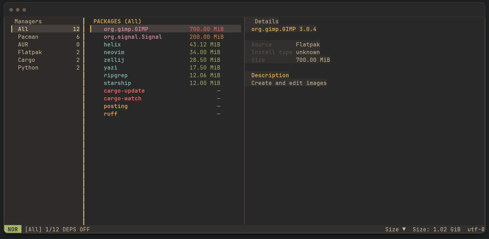

# Omni

Omni is a keyboard-driven terminal package manager that brings Pacman, AUR, Flatpak, Cargo, uv, pip, and project dependencies into one focused inventory.

> **Release status:** 1.0.0 candidate. The stable release will be published after this release branch is merged and the `v1.0.0` tag is created.



*Screenshots use fictional package data. [Watch the animated demo](docs/images/omni-demo.gif) or [view the help screen](docs/images/omni-help.png).*

## Features

- Search, sort, and inspect packages across supported managers.
- Hide dependency packages by default, with an option to show them.
- Discover updates in the background; select, update, or uninstall packages with confirmation.
- Inspect and manage direct dependencies in Cargo, npm, and Bun projects.
- Customize panels, colors, borders, and keybindings with TOML, with live configuration reload.
- List packages as text or JSON from the CLI; persistent logs help diagnose errors.

## Install

### From source with Cargo

Install from a local checkout without publishing to crates.io:

```sh
git clone https://github.com/ThaielSC/Omni.git
cd Omni
cargo install --path . --locked
omni
```

Cargo installs the executable in its configured binary directory, usually `~/.cargo/bin`. To update it from a newer checkout, rerun the install command with `--force`.

### Linux x86-64 downloads

The `v1.0.0` GitHub Release will include an AppImage, a portable `.tar.gz` archive, and `SHA256SUMS` checksums. See [distribution formats](docs/DISTRIBUTION.md) for instructions and requirements.

## Quick start

Run Omni as your normal user. The package managers you want to inspect must be installed and available on `PATH`. On Arch Linux, `pacman-contrib` provides `checkupdates`; some update checks need optional manager tools.

| Key | Action |
| --- | --- |
| `h` / `l`, `Tab` | Switch panels |
| `j` / `k`, arrows | Move through a list |
| `/` | Search by name or description |
| `u` | Show packages with available updates |
| `Space` / `,` | Select a package / clear selection |
| `U` / `d` | Update / review uninstall |
| `e` | Show or hide dependency packages |
| `c` / `C` | Copy package name / Details contents |
| `?` | Open the keybinding help |
| `q` | Quit |

The in-app help lists all active keybindings and can be filtered with `/`.

To inspect packages without opening the TUI:

```sh
omni --list
omni --list --json
omni --list --manager flatpak --sort size
```

## Configuration and security

User configuration lives in `~/.config/omni/`:

- `config.toml`: panels, behavior, and project integrations.
- `theme.toml`: colors and styles.
- `keymap.toml`: keybindings.
- `managers.toml`: custom package managers.

Omni asks for confirmation before changing packages. When an operation requires system privileges, it opens a masked password prompt and passes the password directly to the process; do not run Omni with `sudo`. Custom manager commands can run arbitrary configured actions, so only enable definitions you trust.

View logs with `omni --logs`; get the log file path with `omni --log-path`. The default is `~/.local/state/omni/omni.log`.

## Development

```sh
cargo fmt --all -- --check
cargo test --all-targets
cargo build --release
```

Operation tests use fixture environments. Review their coverage and limitations before trying package actions on a real system.

## Documentation

- [Provider coverage and metadata limits](docs/PROVIDER_SUPPORT.md)
- [Distribution formats](docs/DISTRIBUTION.md)
- [Security review](docs/SECURITY_REVIEW.md)
- [Versioning and releases](docs/VERSIONING.md)
- [Changelog](CHANGELOG.md)
- [MIT License](LICENSE)
